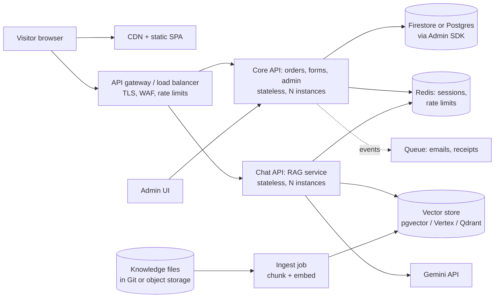

# Architecture: Shubham Kasar Digital HQ

Scope: the website (Shunya book, Codagram, founder), checkout/admin, and the RAG chatbot.
Written against the code as of this commit, then extended to a scalable target.

## 0. Fix first (these are real problems today)

| # | Problem | Where | Risk | Fix |
|---|---|---|---|---|
| 1 | Firestore rules are open: `list: true` on `orders` and `submissions`, and `update` / `settings` writes are allowed for any valid id | `firestore.rules` | Anyone who knows the project config (it is public in the web bundle) can read buyer names, emails, phones and addresses, and can change the UPI ID in `settings/payment_config` | Move the server to the **Firebase Admin SDK** (service account) and set rules to `allow read, write: if false`. All access goes through your API. |
| 2 | Admin sessions and login rate-limit live in server memory (`activeAdminSessions`, `loginRateLimiter` Maps) | `server.ts` | With more than one instance, a login on instance A is invalid on B, and lockouts are bypassed by hitting another instance. A restart logs everyone out. | Signed JWT or session ids in Redis; rate limits in Redis. |
| 3 | The server uses the Firebase *client* SDK | `server.ts` | This is why the rules in #1 had to be open | Same fix as #1. |
| 4 | No rate limit on `/api/companion/ask`, `/api/gemini/chat` | `server.ts` | One visitor can burn your Gemini quota (free tier: 5 req/min) or bill | Per-IP limit plus a daily budget cap (section 5). |
| 5 | Orders and testimonials exist both as in-memory seed arrays and in Firestore | `server.ts` | Two sources of truth | Firestore only; seed via a script. |

## 1. Current system

```
Browser (React 19 + Vite SPA)
   │  fetch /api/*
   ▼
Single Node/Express process (server.ts, ~1500 lines)
   ├─ Admin auth (in-memory sessions)         ─┐
   ├─ Orders / submissions / testimonials      ├─ Firestore (client SDK)
   ├─ UPI settings, SEO config, founder photo ─┘
   ├─ Terminal commands (static text)
   └─ Chatbot → rag/engine.ts → Gemini API
                     └─ reads knowledge/*.md at startup
```

Fine for launch and low traffic. The limits are: one process holds state, the chatbot shares a process with checkout, and the book index is rebuilt on every start.

## 2. Target architecture



### Why split Core API and Chat service
- Different load shapes: chat is slow (LLM calls, seconds) and bursty; checkout must stay fast and up.
- Different scaling and blast radius: a chat spike or Gemini outage must never take checkout down.
- Different secrets: only Chat holds the Gemini key; only Core holds payment/admin secrets.

Start as one repo with two entry points (`apps/api`, `apps/chat`), not two repos.

## 3. Components

### 3.1 Frontend
- Static build on a CDN (Vercel / Cloud Run + CDN / Firebase Hosting). No Node server for the SPA.
- Code-split heavy sections (3D book viewer, AI studio modal, admin dashboard) with `React.lazy`.
- The chat UI streams tokens (SSE) so answers feel instant despite LLM latency.

### 3.2 Core API (checkout, forms, admin)
- Stateless. Config from env. Health endpoint `/healthz`.
- Orders: write order, return id; payment verification stays manual or via a UPI/payment-gateway webhook. Idempotency key on order creation.
- Admin auth: short-lived JWT (15 min) + refresh token in an httpOnly cookie, stored/revocable in Redis; Google login kept; optional 2FA.
- Emails/receipts through a **queue** (Cloud Tasks / BullMQ), so a slow mail provider never blocks a request.
- Input validation (zod) on every route; request size limit lowered from 15 MB except the single photo-upload route.

### 3.3 Chat / RAG service
Pipeline (already implemented in `rag/engine.ts`):

```
question → small-talk / quote shortcuts
         → hybrid retrieval (BM25 + embeddings, rank fusion)
         → relevance gate (refuse if nothing close)
         → Gemini answers from numbered passages, JSON output
         → server verifies: citations valid, quotes verbatim
         → answer + sources   (or "I don't have that")
```

Scaling changes:
| Concern | Now | Target |
|---|---|---|
| Index storage | In memory, rebuilt on boot; cache in `.rag-cache/` | Vector DB (pgvector or Vertex AI Vector Search). The ingest job writes it; chat instances only read. |
| Ingestion | Reads files at startup | A separate **ingest job** triggered when `knowledge/` changes (CI step or admin button). Content-hash per chunk so only changed chunks are re-embedded (already done). |
| Corpus size | A few hundred KB works in memory | A full book is still small (a few MB). In-memory is fine to ~100k chunks; move to a vector DB when you add many documents or need multiple instances sharing one index. |
| Answer cache | In-process Map | Redis (shared across instances), TTL 30 min, key = normalised question + knowledge version. |
| Conversation memory | Client sends last 6 turns | Same (stateless server); store transcripts only if you need analytics and have a privacy notice. |
| Evaluation | Manual | A regression suite of question → expected-source pairs run in CI before each deploy. |

Versioning: tag the index with a `knowledge_version` (git hash). Cache keys include it, so an update never serves stale answers.

### 3.4 Data
| Data | Store | Notes |
|---|---|---|
| Orders, submissions, testimonials, settings | Firestore (keep) or Postgres | Firestore is fine at this scale. Move to Postgres only if you need relational reporting/joins. Always via Admin SDK. |
| Sessions, rate limits, answer cache | Redis (Upstash / Memorystore) | |
| Knowledge text | Git repo (source of truth) | Reviewable, versioned. |
| Embeddings | Vector store (or in-memory + file cache while small) | Derived data; can always be rebuilt. |
| Founder photo / book images | Object storage (GCS / S3) + CDN | Currently a data URL in a Firestore doc; move to storage and keep the URL. |

### 3.5 Security
- Firestore rules: deny all client access; server uses Admin SDK (fix #1/#3).
- Secrets in a secret manager, never in `.env.example` (a real key was once placed there; `.env` is git-ignored, `.env.example` is not).
- WAF + per-IP rate limits at the gateway; stricter on chat and login.
- PII (buyer name/email/phone/address): minimise, restrict admin access, add a retention policy.
- Chat: treat knowledge files as data, not instructions (prompt-injection guard: the system prompt already says "use only passages"; keep user text out of the system prompt).
- Dependency pinning; resolve the existing `@vitejs/plugin-react` peer conflict so installs are reproducible.

### 3.6 Observability
- Structured JSON logs with request id; Sentry for errors.
- Chat metrics: questions/day, % answered vs refused, retrieval score distribution, Gemini latency, 429 rate, cost.
- **Unanswered-questions log**: every refusal is saved. This is your content roadmap for what to add to the knowledge base.
- Uptime check on `/healthz` for each service.

## 4. Deployment
- **Phase 1 (now to a few thousand visitors/day):** one Cloud Run (or Render/Fly) service running the current app, min 1 instance, Firestore, Gemini on a paid key. Do fixes #1, #2 (Redis or a signed-token session), #4.
- **Phase 2:** static SPA on CDN; Core API and Chat API as two Cloud Run services (autoscale 1–N, concurrency ~40 for API, ~10 for Chat); Redis; CI/CD (typecheck, RAG regression tests, deploy).
- **Phase 3 (only if needed):** vector DB, queue workers for email/receipts, multi-region read cache, A/B testing of prompts.

## 5. Cost and capacity guardrails
- Chat is the only expensive path. Per question: 1 embedding call + 1 generation call.
- Controls: answer cache; per-IP limit (e.g. 10 questions/min, 100/day); global daily cap with a friendly "come back tomorrow" message; shortcuts (small talk, quotes) avoid model calls entirely.
- The Gemini free tier allows ~5 requests/min, enough only for testing. Enable billing before launch.

## 6. Suggested repo layout
```
apps/
  web/        React SPA
  api/        checkout, forms, admin
  chat/       RAG service (rag/engine.ts moves here)
packages/
  shared/     types, zod schemas
knowledge/    book + Codagram facts (source of truth)
tests/rag/    question → expected source cases
docs/
```

## 7. Order of work
1. Admin SDK + lock Firestore rules (security, 1–2 days).
2. Rate limits + daily budget on chat; paid Gemini key.
3. Full book into `knowledge/`; add the RAG regression tests and the unanswered-questions log.
4. Sessions/rate limits to Redis; split chat into its own service.
5. Move images to object storage; static SPA to CDN; queue for emails.
6. Vector DB only when the corpus or instance count demands it.
